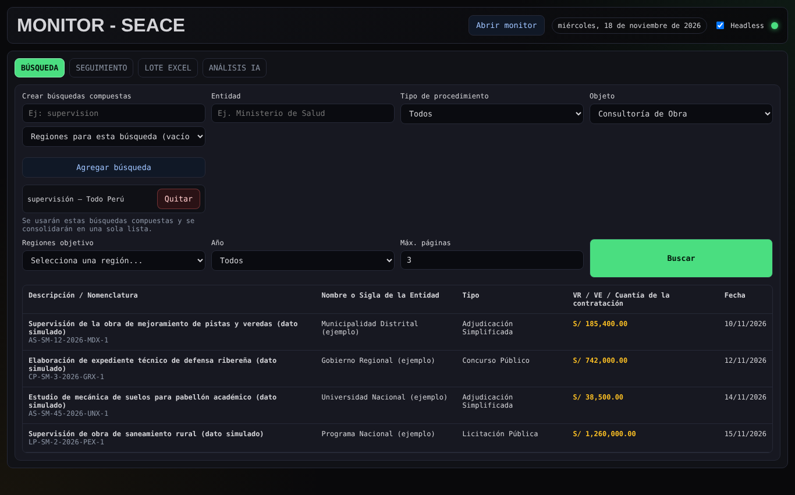

# SEACE Monitor · Seguimiento de contrataciones públicas del Perú

Aplicación full-stack para buscar y dar seguimiento a procedimientos de selección publicados en el SEACE (Sistema Electrónico de Contrataciones del Estado). Automatiza la búsqueda en el portal público, consolida los resultados en una sola tabla, extrae el cronograma de cada proceso y genera un análisis con IA para decidir si conviene postular.

Nació de una necesidad real: revisar a diario licitaciones de supervisión, expedientes técnicos y estudios geotécnicos sin hacerlo a mano en el portal.



*Captura con datos simulados.*

## Funcionalidades

- **Búsquedas compuestas:** varias palabras clave y regiones a la vez, filtradas por entidad, tipo de procedimiento, objeto y año, consolidadas en una sola lista.
- **Cronograma del proceso:** extrae las fechas clave de cada convocatoria; si el portal las muestra como imagen, las lee con OCR (Tesseract).
- **Seguimiento:** guarda los procesos de interés en el navegador para revisarlos después.
- **Lote desde Excel:** carga una lista de procesos exportada de Excel en CSV y la procesa en segundo plano, con el avance en tiempo real.
- **Análisis con IA:** resume cada proceso y señala requisitos y riesgos usando la API de Anthropic; si no hay clave configurada, entrega un análisis local básico.
- **Registro en vivo:** el backend envía cada paso del scraping al frontend por Server-Sent Events.

## Arquitectura

```
React + Vite (frontend)  ──REST / SSE──▶  Flask (backend)  ──Playwright──▶  Portal público del SEACE
                                              │
                                              └──▶ API de Anthropic (análisis, opcional)
```

| Endpoint | Uso |
| --- | --- |
| `POST /api/search` | Búsqueda con filtros |
| `POST /api/cronograma` | Cronograma de un proceso |
| `POST /api/batch` · `GET /api/batch/status` | Procesamiento por lote |
| `POST /api/analyze` | Análisis con IA |
| `GET /api/logs` | Registro en vivo (SSE) |
| `GET /api/health` | Estado del backend |

## Tecnologías

Python · Flask · Playwright · Tesseract OCR · React · Vite · Server-Sent Events · API de Anthropic

## Cómo ejecutarlo

Requisitos: Python 3.10+, Node.js 18+ y, para el OCR, Tesseract instalado.

```bash
git clone https://github.com/josuega96/seace-monitor.git
cd seace-monitor
python setup.py                          # crea .venv e instala dependencias y Chromium para Playwright
.venv/Scripts/python backend/server.py   # Windows; en Linux o macOS: .venv/bin/python backend/server.py
                                         # backend en http://localhost:8080

cd frontend
npm install
npm run dev                     # frontend en http://localhost:5173
```

Para el análisis con IA, define la variable de entorno `ANTHROPIC_API_KEY` antes de iniciar el backend.

## Organización del proyecto

```
backend/   API Flask y scraper con Playwright
frontend/  Interfaz en React
docs/      Mapa técnico, guías operativas y bitácoras
gtd/       Gestión del trabajo: pendientes, decisiones e historial de errores
scripts/   Automatizaciones para Windows (PowerShell)
```

El proyecto se gestiona con un tablero GTD dentro del repositorio (`gtd/`), que registra decisiones de diseño, errores resueltos y próximos pasos.

## Uso responsable

Consulta solo información pública del SEACE, a ritmo moderado y sin evadir controles de acceso.

## Autor

Josué Guzmán Arpasi · Ingeniero de Minas (CIP 409126) · [GitHub](https://github.com/josuega96)
